<div align="center">

# 선행퀘스트 (Good Deed Quest)

**작은 선행을 퀘스트로 바꾸는 AI 공익 앱**

AI가 나에게 맞는 선행을 골라 주고, 사진 한 장으로 인증하면 보상이 쌓이고, 그 기록이 숏폼 영상으로 남습니다.

[발표 영상](https://www.youtube.com/watch?v=8RYjzFgwSRk&t=167s) · [기획 · 설계 문서](https://lavish-lettuce-699.notion.site/abf10f046ae6833eb15e01bd6962af3c)

</div>

### 사용 화면

퀘스트 등록 → 인증 → 커뮤니티 → 상점 · 아이템 장착 → 팀 찾기 · 만들기 → 숏폼 제작까지, AI가 거절하는 실패 장면도 함께 담았습니다. 3배속입니다.

<p align="center">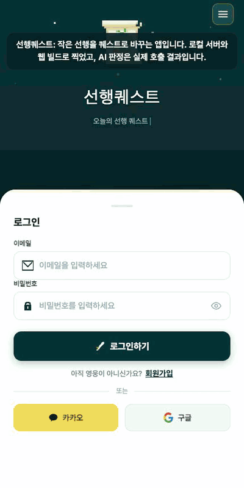</p>

원래 속도(5분 3초 · 자막 있음 · 소리 없음)는 [영상 파일](docs/demo.mp4)을 내려받아 보세요.

| 홈 | 커뮤니티 | 지도 |
|---|---|---|
| 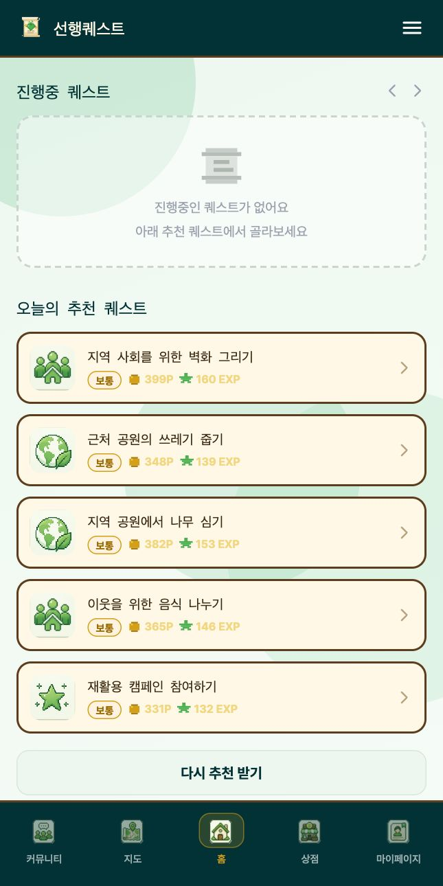 | 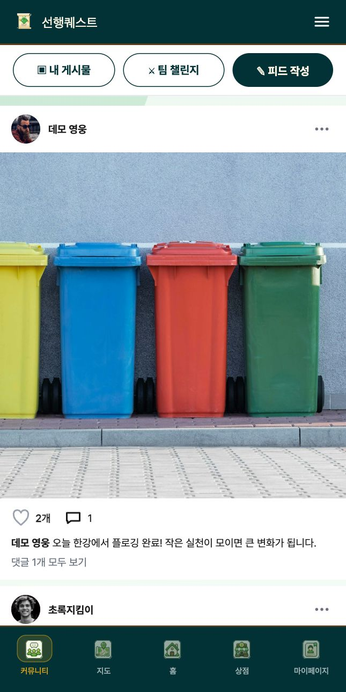 | 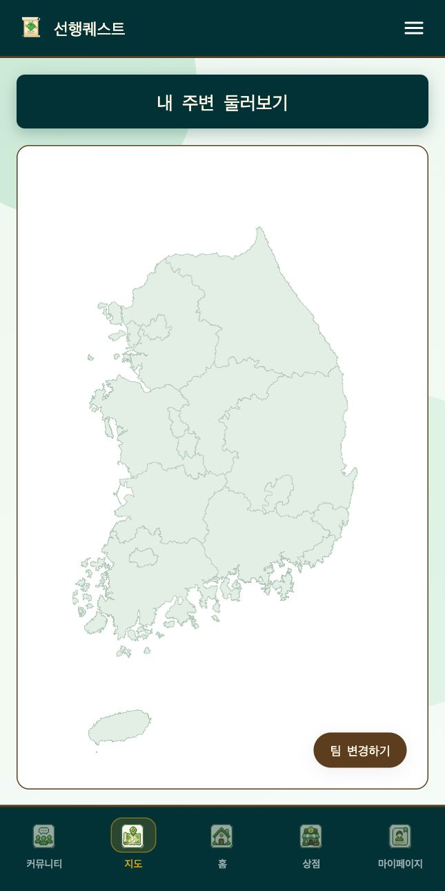 |
| **상점** | **마이페이지** | **로그인** |
|  | 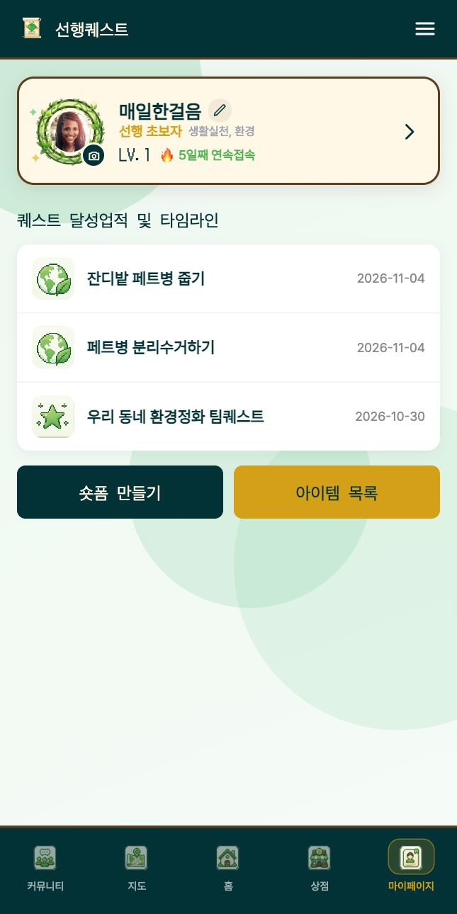 | 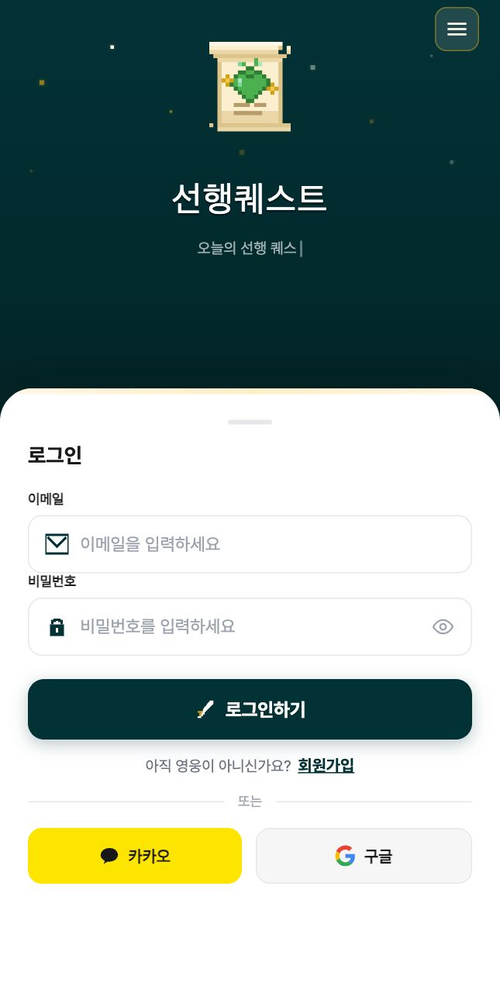 |

**퀘스트 인증** · 영상을 올리면 AI가 퀘스트를 정말 했는지 판정합니다. 오래된 영상과 내용이 맞지 않는 영상은 이유와 함께 돌려보냅니다.

| 영상 · 사진 올리기 | 거절: 오래된 영상 | 거절: 내용이 다른 영상 | 인증 완료 |
|---|---|---|---|
| 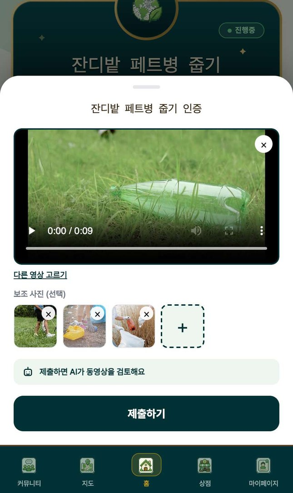 | 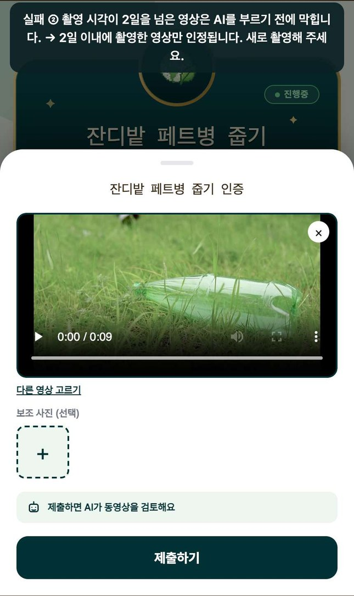 | 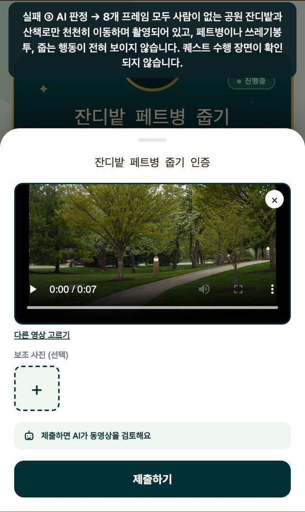 | 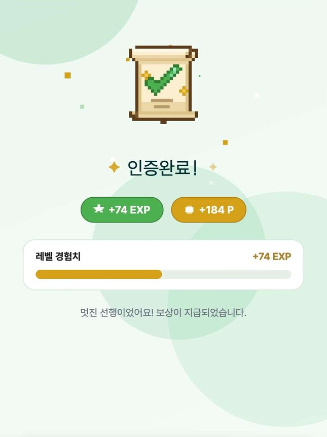 |

**AI 숏폼 만들기** · 인증한 사진과 영상을 고르면 AI가 자막을 쓰고, 음악을 입혀 영상으로 만들어 줍니다.

| 사진 고르기 | AI 자막 | 영상 생성 | 완성 |
|---|---|---|---|
| 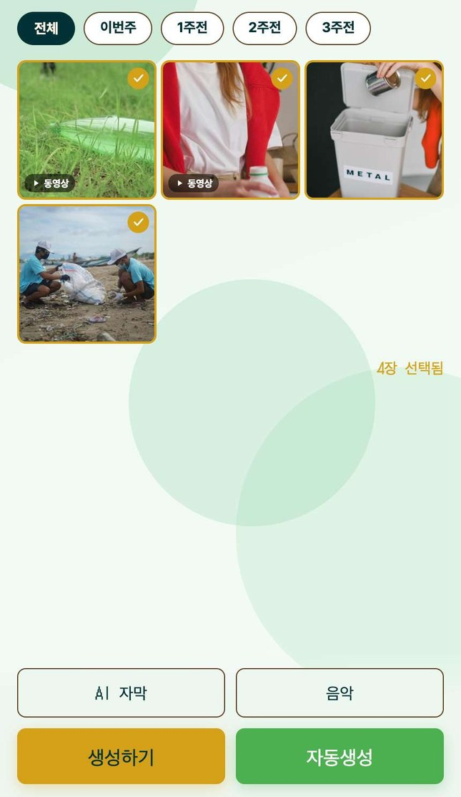 | 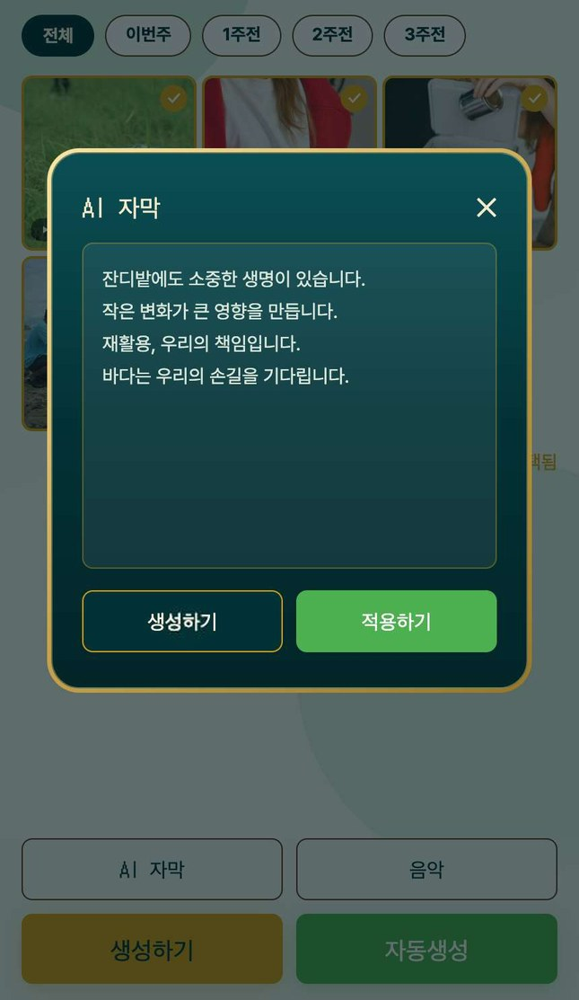 | 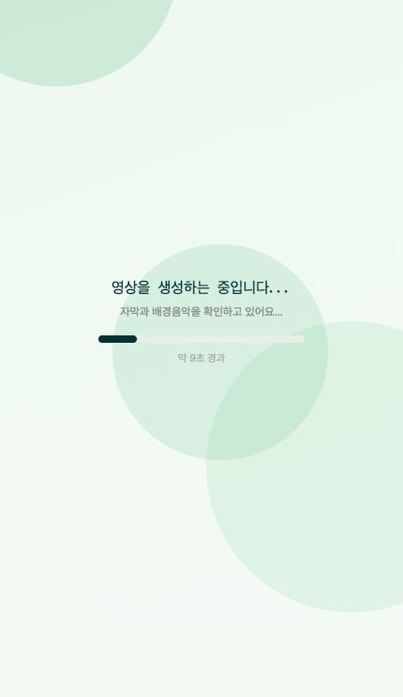 | 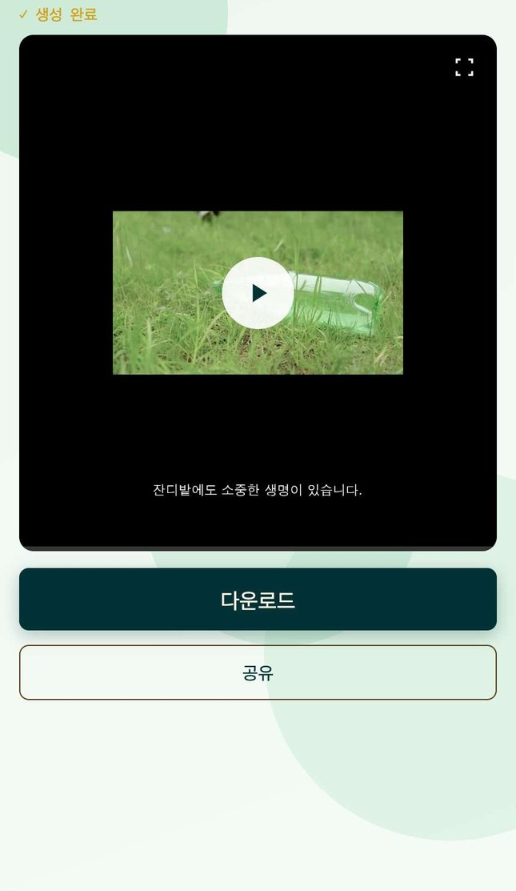 |

> 사진과 움짤은 로컬 서버와 시연 데이터를 웹 빌드로 띄워 찍었습니다. 인증 영상·사진은 무료 스톡 소재([Pexels](https://www.pexels.com/license/))이고, 스톡 영상은 촬영 시각 정보를 지운 사본입니다. 시연 때 저장소는 S3 대신 로컬 대체품을, AI 호출은 Gemini 자리에 Claude(`claude-opus-5-5`)를 썼습니다. 저장소 코드를 고친 것은 아니며, AI 판정은 실제 호출 결과입니다. 폰 앱에서는 돌려 보지 않았습니다. 인증과 숏폼 사진은 시연 녹화에서 커서를 지우고 위아래를 잘랐고, 안내 자막도 지웠습니다. 거절 사진의 위쪽 글만 남겼는데, 앱이 돌려준 거절 이유를 시연용 자막으로 옮긴 것입니다. 이 시연은 AI 자막과 음악을 따로 고른 뒤 `생성하기`로 만들었고, 초록색 `자동생성` 버튼은 눌러 보지 않았습니다.

## 왜 만들었나

선행을 하고 싶어 하는 사람은 많은데, 실제 행동으로 잘 이어지지 않습니다.

- **뭘 해야 할지 모릅니다.** 무엇을 어디서 할 수 있는지 알기 어렵습니다.
- **정보가 흩어져 있습니다.** 1365, 지자체, 기관마다 따로 있습니다.
- **계속할 이유가 없습니다.** 기존 플랫폼은 정보 제공에 그칩니다.
- **인증이 번거롭습니다.** 실제로 했는지 확인할 방법이 마땅치 않습니다.

그래서 게임의 퀘스트 · 레벨 · 보상 구조를 선행에 옮겼습니다.

## 주요 기능

| 기능 | 하는 일 |
|---|---|
| **AI 퀘스트 추천** | 관심사 · 위치 · 활동 이력으로 맞춤 퀘스트와 추천 이유를 제시합니다 |
| **Vision AI 인증** | 인증 사진을 보고 AI가 수행 여부를 판정합니다. 보류된 건은 주기 작업이 다시 판정합니다 |
| **퀘스트 등록** | 직접 만든 퀘스트를 AI가 심사하고 보상을 정합니다 |
| **AI 숏폼 생성** | 인증 사진에 AI 자막과 BGM을 입혀 세로 영상을 만듭니다 |
| **지도 퀘스트** | 전국 봉사 공고 4,950건을 위치로 찾고, 지역 랭킹과 대항전을 봅니다 |
| **커뮤니티 · 팀 챌린지** | 인증을 피드로 나누고, 팀을 만들어 함께 퀘스트를 합니다 |
| **성장 · 보상** | 포인트, 경험치, 레벨, 배지, 상점의 프로필 테두리 |
| **소셜 로그인** | 이메일, 카카오, 구글. 앱이 보낸 토큰을 백엔드가 검증합니다 |

## 구조

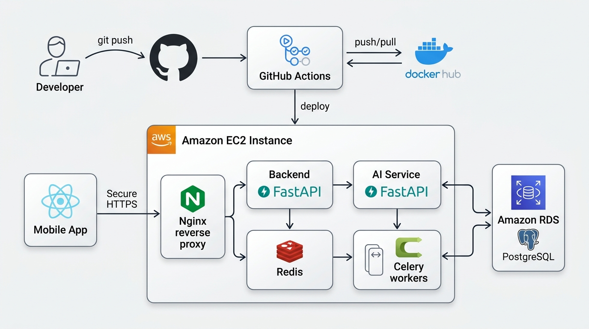

- 앱은 `backend`하고만 통신합니다. `ai`는 외부에 노출하지 않고 `backend`가 내부에서 호출합니다.
- 인증 사진과 숏폼 영상은 S3에, 나머지 데이터는 PostgreSQL에 저장합니다.
- 오래 걸리는 작업은 Celery가 맡습니다.

기능별 AI 흐름은 [`docs/AI-WorkFlow`](docs/AI-WorkFlow)에, ERD와 페이지 흐름도, 스토리보드는 [`docs`](docs)에 있습니다.

**기술:** Python 3.12 · FastAPI · SQLAlchemy · Alembic · Celery · PostgreSQL(pgvector) · Redis · LangGraph · LangChain · OpenAI · Gemini Vision · FAISS + BM25 · FFmpeg · React Native · Expo SDK 54 · TypeScript · Docker · AWS(EC2 · RDS · S3) · nginx · GitHub Actions

## 내 컴퓨터에서 실행하기

프로젝트가 끝나 자동 배포를 껐습니다. 아래는 로컬에서 띄우는 방법입니다.

```bash
cp .env.example .env              # SECRET_KEY, OPENAI_API_KEY, GEMINI_API_KEY 등을 채웁니다
docker compose up -d              # PostgreSQL, Redis
python -m venv .venv && source .venv/bin/activate
pip install -r requirements.lock.txt
alembic -c backend/alembic.ini upgrade head
python -m backend.app.quest.seed_category
```

프로젝트 루트에서 서버를 켭니다.

```bash
uvicorn backend.main:app --reload --host 0.0.0.0
```

```bash
uvicorn ai.main:app --reload --port 8001
```

앱을 켭니다. 카카오 · 구글 로그인 네이티브 모듈이 있어 **Expo Go로는 열리지 않고** development build가 필요합니다.

```bash
cd frontend
npm ci
npx expo start --dev-client
```

- `backend/requirements.txt`만으로는 모듈이 빠져 서버가 켜지지 않습니다. `requirements.lock.txt`를 쓰세요.
- 데모 데이터는 `python -m backend.mj_seed_demo_data`로 넣습니다(계정 10명, 퀘스트 6개, 팀 3개). 데모 사진을 올릴 S3 버킷이 필요합니다.
- 웹 빌드는 공식 지원이 아닙니다. 토큰 저장에 쓰는 `expo-secure-store`가 웹을 지원하지 않습니다.

## 폴더

```text
backend/    메인 API (인증 · 퀘스트 · 인증 처리 · 지도 · 성장 · 커뮤니티 · 숏폼 · 관리자)
ai/         AI 서비스 (추천 · Vision 인증 · 코치 · 숏폼)
frontend/   React Native 앱
deploy/     운영 compose · nginx
docs/       설계 문서 · 흐름도 · 배포 기록
```

각 폴더의 README에 자세한 설명이 있습니다. 코드 규칙은 [`CONVENTION.md`](CONVENTION.md), 배포 기록은 [`docs/배포.md`](docs/배포.md)를 보세요.

## 팀 · 퀘스트 지상주의

| 이름 | GitHub | 담당 |
|---|---|---|
| **최홍묵** (팀장) | [@LeoChoi224](https://github.com/LeoChoi224) | 퀘스트 추천 로직 · 상점 & 포인트 · 배포 인프라 |
| **문태현** | [@Moontaehyeon01](https://github.com/Moontaehyeon01) | AI 숏폼 생성 · 마이 페이지 |
| **양정운** | [@yangjungun05-prog](https://github.com/yangjungun05-prog) | 퀘스트 인증 로직 · 인증 & 회원 기능 |
| **이민재** | [@alswo0548](https://github.com/alswo0548) | 커뮤니티 · 팀 추천 · 관리자 대시보드 |
| **정희준** | [@hjj1911](https://github.com/hjj1911) | 지도 퀘스트 · 레벨 & 성장 |

2026.06.26 ~ 2026.08.11 · KoreaITAcademy LangChain을 활용한 AI 영상객체탐지분석 플랫폼 구축 과정 중간 프로젝트
